  
  
  
  

 

## Hello

I'm Abhishek, an **Engineering Management** master's student at **Politecnico di Torino**, with a B.Sc. in Computer Engineering from the same place. I like the seam between engineering and business: taking something technical, understanding who it is for, and shipping it.

Before this I built a VR property-visualization platform as a **Technical Management Trainee at OpenSky VR Italia**, and spent a year and a half as a **Junior Data Analyst at Fibzio** turning SQL and Power BI into decisions. On the side I lead the **Politecnico Indian Students Association**, which reaches more than a thousand students. In 2026 I stood on three hackathon podiums.

<table align="center">
  <tr>
    <td align="center" width="200"><b>🥇 1st</b> LOKI Urban Monitoring Hackathon · Oct 2026</td>
    <td align="center" width="200"><b>🥈 2nd</b> Automation Hackathon Mar 2026</td>
    <td align="center" width="200"><b>🥇 1st</b> Therness Hackathon Feb 2026</td>
    <td align="center" width="200"><b>1,000+</b> students reached as PISA president</td>
  </tr>
</table>

 

## Achievements and certifications

| | What | Detail |
| :-: | --- | --- |
| 🥇 | **404: Pothole Not Found, LOKI Urban Monitoring Hackathon** · 1st place · Oct 2026 | Built **cityX**, an AI civic-intelligence platform that turns street reports into actionable incidents: AI-assisted classification, geospatial analysis, duplicate detection and risk-based prioritisation, with privacy safeguards. |
| 🥈 | **Automation Hackathon** · 2nd place · Mar 2026 | An AI supply-chain risk platform built in five hours. ScrapeGraphAI and LLMs extract supplier intelligence for 1,000+ vendors and flag geopolitical, weather and logistics risks on cargo routes. |
| 🥇 | **Therness Hackathon** · 1st place · Feb 2026 | Analysed 1,551 welding samples across thermal video, audio and sensor data to detect and classify six defect categories. |
| 🎓 | **INSIDE LVMH Certificate** | LVMH's programme on luxury, retail and brand strategy. |
| 🎓 | **McKinsey Forward Program** | Problem solving, adaptability and digital fluency. |
| 🎓 | **CS50's Introduction to Computer Science** | Harvard's foundational CS course. |

 

## Selected projects

All of these live in this account. Click a name for the code.

| Project | What it solves | Built with | |
| --- | --- | --- | --- |
| **[Hand-drawn 3D portfolio](https://github.com/iamsammy-ak/portfolio)** | A portfolio you walk through: paper-tear loader, a sketched building, a corridor with doors to four rooms. Every drawing is procedural canvas, no image files. | three.js, GSAP, Canvas 2D | [live ↗](https://iamsammy-ak.github.io/portfolio/) |
| **[ms-project-mcp](https://github.com/iamsammy-ak/ms-project-mcp)** | Microsoft Project desktop has no public API. This MCP server exposes it to AI agents as 51 typed tools over COM: tasks, WBS, dependencies, resources, baselines, earned value. | Python, MCP, COM automation | |
| **[OmniPilot](https://github.com/iamsammy-ak/omni-pilot)** | An AI SOC copilot: threat analysis, Italian NIS2 / ACN compliance reports, honeypot deception and plain-English security Q&A in one console. | Next.js 15, TypeScript | |
| **[M&A Synergy Simulator](https://github.com/iamsammy-ak/SynergySimulator)** | Client-side financial model for merger deals: premiums, pro-forma financials, accretion/dilution, ownership splits and 2D sensitivity heatmaps. | React, TypeScript | [live ↗](https://synergy-simulator.vercel.app) |
| **[RetailPulse BI](https://github.com/iamsammy-ak/retailpulse)** | End-to-end BI delivery for a mock retailer: star-schema SQL Server model, DAX measures, executive Power BI dashboard, testing and docs. | SQL Server, DAX, Power BI | |
| **[StockVault](https://github.com/iamsammy-ak/StockVault)** | A stock-trading platform with portfolio tracking, live quotes from Yahoo Finance, watchlists, stop-loss orders and candlestick charts. | Flask, SQLite, Plotly | |
| **[Smart Stop](https://github.com/iamsammy-ak/smart-stop)** | Accessibility system that lets hearing-impaired passengers identify an arriving bus. Two Raspberry Pis talk over MQTT, with a touchscreen at the stop and an LCD on the bus. | Python, Raspberry Pi, MQTT | |
| **[CineSphere](https://github.com/iamsammy-ak/CineSphere)** | A social network for cinephiles: film logging via TMDB, spoiler-safe reviews, reactions, follows and a unified feed. | ASP.NET Core 8, CQRS / MediatR, Next.js, PostgreSQL | |
| **[RateMyDorm Italy](https://github.com/iamsammy-ak/ratemyDorm)** | Crowdsourced reviews of student residences across Italian universities, with a campus map and side-by-side comparison. | Next.js 14, TypeScript, Leaflet | |

 

## Skills

| | |
| --- | --- |
| **Data and analytics** | SQL (MS SQL, PostgreSQL) · Power BI · DAX · Excel · FP&A forecasting and variance analysis |
| **AI and engineering** | Python · AI / ML · MATLAB · Docker · LLM tooling (MCP, ScrapeGraphAI) |
| **Web** | TypeScript · React · Angular · Next.js · three.js · Flask · ASP.NET Core |
| **Product and delivery** | Project management · Market and startup research · JIRA · Trello · Asana · Notion · Figma |
| **People** | Public speaking · Entrepreneurship · Leading volunteer teams of 10+ · Event budgets and sponsorship |
| **Languages** | Hindi (native) · English (professional) · Italian (beginner) |

 

## Contributions

  

  

Both cards are live data from GitHub: the contribution graph via ghchart.rshah.org, the streak via streak-stats.demolab.com.

 

## Experience in one line each

| When | Role | Where |
| --- | --- | --- |
| 2025 – now | M.Sc. Engineering Management, Business Solutions / Finance | Politecnico di Torino |
| Jan – Jun 2025 | Technical Management Trainee · React, Angular, Matterport, LiDAR · MVP in six months, ~30% faster property presentations | OpenSky VR Italia |
| Sep 2023 – Dec 2024 | Junior Data Analyst · SQL, Power BI, FP&A · 40% faster reporting, 20% fewer incidents | Fibzio |
| Apr 2023 – now | President · strategy and events for 1,000+ students, a Red Bull-sponsored chess tournament with 400+ players | Politecnico Indian Students Association |
| May – Jul 2024 | Logistics Coordinator across 5+ venues | Torino 2025 FISU Games |
| Nov 2022 – Jun 2023 | Marketing Manager · 10+ volunteers | AIESEC |
| 2022 – 2025 | B.Sc. Computer Engineering | Politecnico di Torino |

 

## Find me

  
  
  
  

Turin, Italy · open to collaborations, product and data roles, and the occasional hackathon team.

