

  <a href="https://iamsammy-ak.github.io/portfolio/"></a>
  <a href="https://www.linkedin.com/in/sammy4bhishek/"></a>
  
  


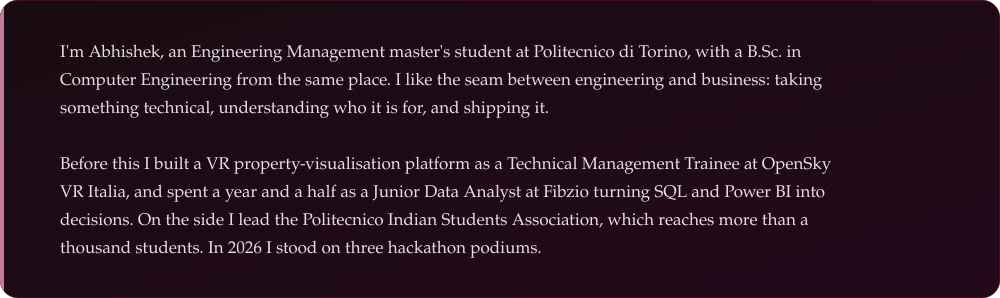





<a href="https://github.com/iamsammy-ak/portfolio">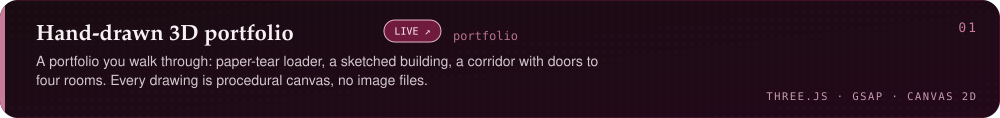</a>
<a href="https://github.com/iamsammy-ak/ms-project-mcp">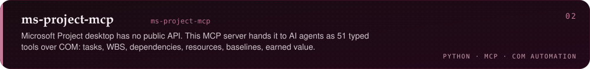</a>
<a href="https://github.com/iamsammy-ak/omni-pilot">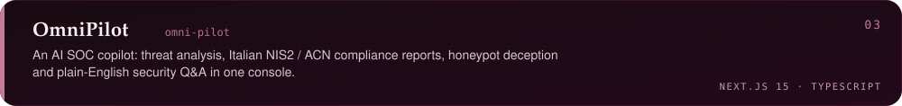</a>
<a href="https://github.com/iamsammy-ak/SynergySimulator">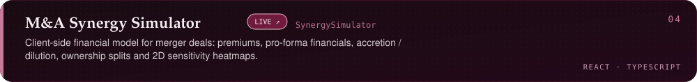</a>
<a href="https://github.com/iamsammy-ak/retailpulse">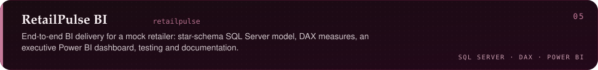</a>
<a href="https://github.com/iamsammy-ak/StockVault">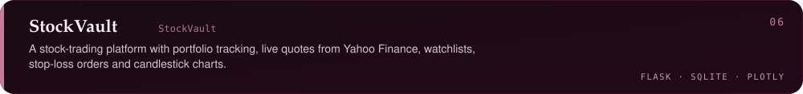</a>
<a href="https://github.com/iamsammy-ak/smart-stop">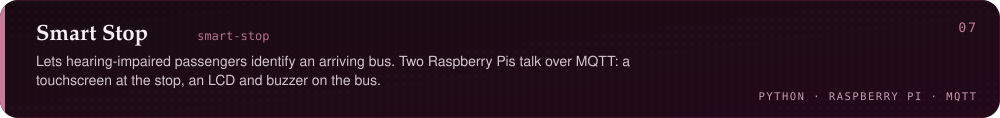</a>
<a href="https://github.com/iamsammy-ak/CineSphere">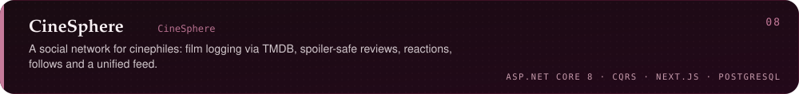</a>
<a href="https://github.com/iamsammy-ak/ratemyDorm">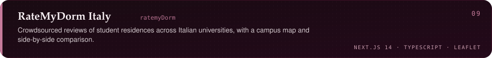</a>

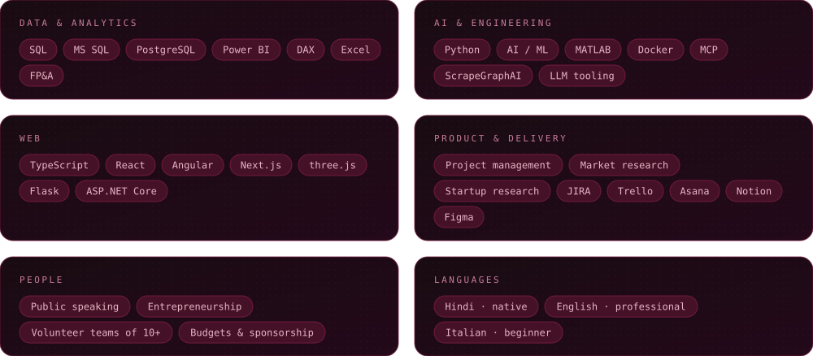


  

  



  <a href="https://github.com/iamsammy-ak"></a>
  
  
  

